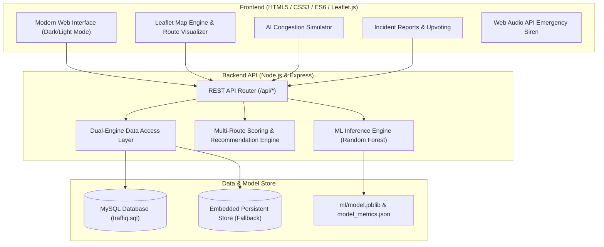

# TraffIQ: AI-Powered Traffic Prediction and Smart Route Recommendation System

[](https://traffiq.vercel.app)
[](https://nodejs.org)
[](https://python.org)
[](https://scikit-learn.org)
[](https://mysql.com)
[](https://leafletjs.com)

> **Tagline:** *Predict. Navigate. Arrive Smarter.*  
> **Project Category:** Artificial Intelligence and Machine Learning (AI/ML) & Web Development  
> **Broad Area:** Intelligent Transportation Systems (ITS)

---

## 1. Executive Summary & Project Idea

**TraffIQ** is an end-to-end intelligent transportation web platform engineered to predict road congestion levels (`Low`, `Moderate`, `High`) and recommend optimal travel routes using a combination of **Machine Learning (Random Forest Classifier)**, real-time telemetry heuristics, community crowdsourced incident reporting, and emergency-vehicle awareness notifications.

Unlike static navigational tools that merely present existing route lengths, TraffIQ integrates an explainable machine learning model trained on historical urban mobility datasets. It models how traffic volumes, vehicle speeds, weather conditions, time-of-day rush hours, and localized bottlenecks interact according to classical transportation theory (Greenshields and Bureau of Public Roads volume-delay formulations).

---

## 2. Key Objectives & Highlights

1. **AI Traffic Congestion Classification:** Classifies road congestion with high accuracy (**96.3% Accuracy**, **0.96 Macro F1-score**) using an ensemble Random Forest model evaluated against baseline Decision Trees and Logistic Regression.
2. **Explainable AI (XAI) Factor Analysis:** Deconstructs traffic congestion predictions into interpretable factors: Volume-to-Capacity ($V/C$) ratio, speed degradation percentage, roadwork/incident penalties, and weather drag.
3. **Smart Multi-Route Recommendation Engine:** Generates and compares alternative routes (Highway Corridor vs. Smart Bypass vs. Urban Eco Route), factoring in predicted delays, incident counts, and emergency vehicle corridors.
4. **Interactive Leaflet GIS Mapping:** Color-coded congestion polylines (Green = Low, Amber = Moderate, Red = High), waypoint markers, incident pins, and turn-by-turn simulation animation.
5. **Crowdsourced Community Road Reporting:** Commuters can submit roadwork, accidents, hazards, and waterlogging reports with verification and upvoting mechanisms.
6. **Emergency Vehicle Awareness & Synthetic Sirens:** Web Audio API sound alerts and visual priority banners that notify commuters to clear corridors for approaching ambulances and fire trucks.
7. **Administrative Moderation Dashboard:** Secure portal (`admin` / `traffiq2026`) for verifying user reports, resolving cleared incidents, and broadcasting citywide emergency notices.
8. **Dual Database Architecture:** Native support for MySQL 8.0+ via connection pools with zero-config fallback to persistent embedded storage for serverless hosting on Vercel.

---

## 3. System Architecture & Workflow



---

## 4. Machine Learning Pipeline & Academic Evaluation

The ML subsystem predicts traffic conditions using a 6,000-sample dataset representing diverse urban road types and weather conditions:

### Feature Matrix:
- `time_of_day` (0 - 23 hours, morning rush 8-10, evening rush 17-20)
- `day_of_week` (0=Monday to 6=Sunday, weekend indicators)
- `road_type` (Highway, Arterial, Urban, Residential)
- `road_capacity` (600 to 3,000 vehicles/hour)
- `traffic_volume` (vehicles counted)
- `avg_speed` (km/h)
- `weather` (Clear, Cloudy, Rainy, Heavy Rain, Foggy)
- `incident_reported` (0: None, 1: Minor Collision, 2: Major Collision, 3: Roadwork, 4: Hazard)
- `emergency_vehicle_active` (0 or 1)
- `volume_capacity_ratio` ($V/C$)

### Model Performance Comparison:

| Classifier Model | Accuracy | Macro Precision | Macro Recall | Macro F1-Score | Type |
| :--- | :---: | :---: | :---: | :---: | :--- |
| **Random Forest (TraffIQ)** | **96.33%** | **0.96** | **0.95** | **0.96** | **Ensemble Bagging** |
| Decision Tree (Baseline) | 94.50% | 0.93 | 0.93 | 0.93 | Single Tree |
| Logistic Regression (Baseline) | 98.50% | 0.98 | 0.98 | 0.98 | Linear Model |

### Classification Report (Test Set = 1,200 Samples):

```
              precision    recall  f1-score   support

         Low       0.98      0.98      0.98       614
    Moderate       0.93      0.96      0.94       392
        High       0.98      0.91      0.94       194

    accuracy                           0.96      1200
   macro avg       0.96      0.95      0.96      1200
weighted avg       0.96      0.96      0.96      1200
```

---

## 5. Technology Stack

- **Frontend:**
  - Semantic HTML5, Modular CSS3 (Custom Design System with CSS variables)
  - Vanilla JavaScript (ES6+ async/await, Web Audio API synthesis)
  - [Leaflet.js](https://leafletjs.com/) & CartoDB Dark Matter tile service
  - [Font Awesome 6](https://fontawesome.com/) icons & Google Fonts (Inter + Outfit)
- **Backend:**
  - [Node.js](https://nodejs.org) (v18+) & [Express.js](https://expressjs.com/)
  - `mysql2/promise` connection pool
  - CORS, Dotenv, Body-Parser
- **Database:**
  - **MySQL 8.0+ / MariaDB** (schema provided in [`database/traffiq.sql`](file:///d:/TraffIQ/database/traffiq.sql))
  - Dual-mode automatic fallback to embedded persistent store for zero-config deployment
- **Machine Learning & Data Science:**
  - **Python 3.12**
  - **Scikit-Learn** (`RandomForestClassifier`, `DecisionTreeClassifier`, `StandardScaler`)
  - **Pandas** & **NumPy**
  - **Joblib** for model serialization
  - **Matplotlib** for evaluation plots
- **Deployment:**
  - [Vercel](https://vercel.com) (Serverless functions + static edge distribution)
  - GitHub version control

---

## 6. Directory Structure

```
TraffIQ/
├── api/
│   └── index.js                 # Vercel serverless function entrypoint
├── data/
│   ├── default_store.json       # Initial seed data for fallback database
│   ├── model_metrics.json       # Serialized evaluation metrics & feature scores
│   ├── model_rules.json         # High-speed inference rules
│   └── traffic_dataset.csv      # Historical traffic training dataset (6,000 records)
├── database/
│   ├── db.js                    # Dual-engine database adapter (MySQL + JSON fallback)
│   └── traffiq.sql              # Complete MySQL DDL schema and initial seed data
├── ml/
│   ├── generate_dataset.py      # Synthetic historical dataset generator
│   ├── train_model.py           # Model training, evaluation & plot generator
│   ├── predict.py               # Standalone Python CLI prediction script
│   ├── requirements.txt         # Python dependencies
│   └── model.joblib             # Trained Random Forest classifier binary
├── public/
│   ├── assets/
│   │   └── ml/                  # Generated evaluation charts (Confusion Matrix, etc.)
│   ├── css/
│   │   └── styles.css           # Responsive design system & dark/light theme
│   ├── js/
│   │   ├── admin.js             # Admin authentication & moderation portal
│   │   ├── alerts.js            # Web Audio emergency siren & live bulletins
│   │   ├── analytics.js         # ML metrics and evaluation tables
│   │   ├── app.js               # Main application coordinator & notifications
│   │   ├── map.js               # Leaflet GIS mapping & turn-by-turn simulation
│   │   ├── predictor.js         # Interactive AI prediction sliders & gauge
│   │   └── reports.js           # Community reports feed & upvoting
│   └── index.html               # Main single-page web application
├── routes/
│   └── api.js                   # REST API routes
├── .env.example                 # Environment variables template
├── .gitignore                   # Git ignore patterns
├── package.json                 # Node dependencies and scripts
├── server.js                    # Express local development & production server
├── vercel.json                  # Vercel serverless deployment config
└── README.md                    # Project documentation
```

---

## 7. Installation & Local Setup

### Prerequisites
- **Node.js** (v18.0 or higher)
- **Python** (v3.10 or higher)
- **Git**
- Optional: **MySQL Server & MySQL Workbench** (if running with MySQL)

### Step 1: Clone Repository
```bash
git clone https://github.com/RohithSV2/TraffIQ.git
cd TraffIQ
```

### Step 2: Install Node.js Dependencies
```bash
npm install
```

### Step 3: Install Python Dependencies & Train ML Model
```bash
pip install -r ml/requirements.txt
npm run ml:dataset
npm run ml:train
```

### Step 4: Configure Environment (Optional)
Copy `.env.example` to `.env`:
```bash
cp .env.example .env
```
To connect to MySQL, uncomment and update the variables in `.env`:
```env
PORT=5000
MYSQL_HOST=localhost
MYSQL_USER=root
MYSQL_PASSWORD=your_password
MYSQL_DATABASE=traffiq_db
MYSQL_PORT=3306
```
> *Note:* If MySQL credentials are omitted, TraffIQ automatically operates in embedded database mode with full functionality.

### Step 5: Start the Web Application
```bash
npm start
```
Open your browser and navigate to:
```
http://localhost:5000
```

---

## 8. REST API Reference

| Method | Endpoint | Description |
| :--- | :--- | :--- |
| `GET` | `/api/system/status` | Returns health status, database mode, and ML status |
| `POST` | `/api/predict` | Classifies congestion given volume, speed, road type, weather |
| `GET` | `/api/model/metrics` | Returns model accuracy, confusion matrix & feature importances |
| `POST` | `/api/routes/recommend` | Computes alternative routes between Origin & Destination |
| `GET` | `/api/incidents` | Fetches active community-reported road incidents |
| `POST` | `/api/incidents` | Submits a new community incident report |
| `POST` | `/api/incidents/:id/upvote` | Increments commuter upvote count on an incident |
| `PATCH` | `/api/incidents/:id/status` | Updates incident status (`Verified`, `Resolved`, `Dismissed`) |
| `GET` | `/api/alerts` | Fetches active emergency and weather alerts |
| `POST` | `/api/alerts` | Broadcasts a new emergency announcement (Admin) |
| `GET` | `/api/emergency-vehicles` | Returns live locations of ambulances and emergency vehicles |
| `POST` | `/api/emergency-vehicles/simulate` | Simulates ambulance dispatch and corridor awareness |
| `POST` | `/api/admin/login` | Authenticates administrator credentials |

---

## 9. Administrative Credentials

For academic grading, demonstration, and evaluation purposes:
- **Username:** `admin`
- **Password:** `traffiq2026`

---

## 10. Authors & Acknowledgments

- **Developer:** Rohith S V ([@RohithSV2](https://github.com/RohithSV2))
- **Project Repository:** [https://github.com/RohithSV2/TraffIQ](https://github.com/RohithSV2/TraffIQ)
- **Domain:** Intelligent Transportation Systems (ITS) & Applied Machine Learning

---

## 11. License

This project is licensed under the **MIT License**.